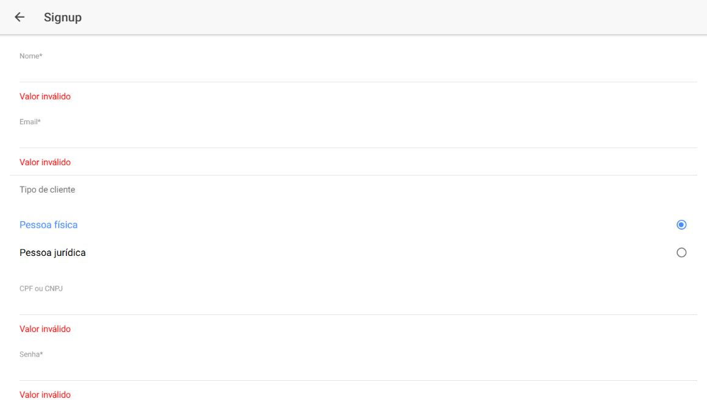
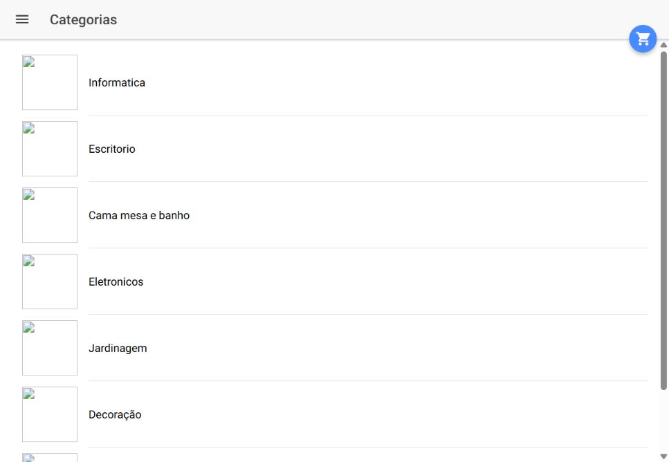
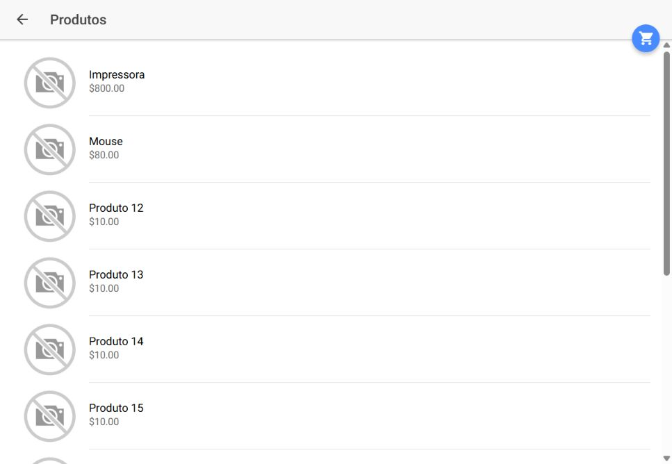

# Sistema de Pedidos Aplicativo Ionic

Aplicativo híbrido de pedidos com login, cadastro de cliente, categorias, produtos, carrinho e etapas de seleção de endereço e pagamento. Ele fornece a interface para o backend Spring da mesma aplicação.

**Categoria:** Frontend · Aplicativo híbrido.

## Tecnologias principais

- TypeScript
- Ionic 3.9.9
- Angular 5.2.11
- Cordova

## Fluxos implementados

- Entrada com email e senha e manutenção do token de autenticação.
- Cadastro de cliente com endereço, estado e cidade.
- Consulta de categorias e produtos.
- Detalhes de produto e gerenciamento de carrinho.
- Seleção de endereço, forma de pagamento e confirmação do pedido.
- Perfil do cliente e integração com câmera por plugin Cordova.

## Backend correspondente

A aplicação consome [Spring Boot Ionic Backend](https://github.com/murillomtz/spting-boot-ionic-backend). A configuração fica em `src/config/api.config.ts`, com a URL da API e o endereço das imagens. O backend utiliza a porta 8081 por padrão.

As imagens de categorias e produtos dependem do serviço externo configurado. A leitura de dados da API e a disponibilidade dessas imagens são requisitos distintos.

## Organização

`src/pages/` contém as telas do fluxo. `src/services/` reúne autenticação, armazenamento e serviços de domínio. Os interceptadores adicionam autenticação às chamadas e tratam as respostas de erro. `config.xml` contém a configuração Cordova.

## Executar e compatibilidade

Trata-se de Ionic 3, com ferramentas antigas. O manifesto original mistura `@angular/compiler-cli 10` e `@angular/http 7` com Angular 5.

Para compilar a cópia local das capturas, foram utilizados Node.js 14.21.3, compiler-cli e http **5.2.11**, TypeScript **2.6.2** e `cordova-plugin-camera 4.1.0` obtido pelo registro npm. Essas alterações de dependências não foram publicadas nesta atualização.

Depois de alinhar as dependências e iniciar o backend:

```bash
npm install
npm start
```

O script de inicialização usa `ionic-app-scripts serve`. Para gerar a interface web, use `npm run build`; funcionalidades nativas exigem um ambiente Cordova e um dispositivo compatível.

## Execução das capturas

A interface compilada foi aberta no navegador. O login de demonstração, a consulta de categorias e a listagem de produtos responderam com dados do backend original, executado com o perfil `test` e H2 em memória. O cadastro foi fotografado com os campos pessoais vazios, mostrando as validações do formulário.

O endereço antigo das imagens de categorias não respondeu; os produtos exibiram o recurso padrão de imagem indisponível. O checkout completo, a câmera e os serviços externos de email e armazenamento não foram verificados.

## Capturas do sistema

Capturas reais obtidas em execução local em 12/10/2026.

### Página inicial


### Formulário de cadastro e suas validações



### Categorias recebidas da API



### Produtos recebidos da API



## Histórico

Repositório criado no GitHub em **2020-07-23**. Essa data identifica a criação do repositório; não comprova o início nem a conclusão do desenvolvimento.
